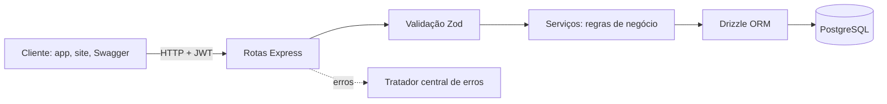

<h1 align="center">Saldo API</h1>

<p align="center">
  <strong>API REST de controle financeiro pessoal</strong><br/>
  Contas, lançamentos parcelados, transferências, orçamentos com alerta, metas e relatórios.
</p>

<p align="center">
  
  
  
  
  
  
</p>

<p align="center">
  <a href="https://saldo-api-matheus.vercel.app"><strong>API no ar</strong></a> ·
  <a href="https://saldo-api-matheus.vercel.app/docs">Documentação interativa (Swagger)</a>
</p>

> Conta de demonstração: **demo@saldo.dev** / **demo123**, com 6 meses de dados.

## O que ela faz

Uma API pensada para um app de finanças pessoais, com as regras que aparecem no dia a dia de quem controla
dinheiro no Brasil:

- **Contas** (corrente, poupança, carteira, cartão de crédito, investimentos) com saldo atual e saldo previsto
- **Lançamentos** de receitas e despesas, pagos ou pendentes (contas a pagar/receber)
- **Compras parceladas**: `installments: 10` cria 10 lançamentos mensais que somam exatamente o total
  (R$ 100,00 em 3x = 33,34 + 33,33 + 33,33) e respeita fim de mês (31/01 → 28/02 → 31/03)
- **Transferências** entre contas, que mexem no saldo mas não contam como receita nem despesa
- **Filtros** por período, conta, categoria, tipo, situação e busca, com **paginação**, ordenação
  e totais do conjunto filtrado
- **Orçamentos** mensais por categoria, com status `ok`, `warning` (a partir de 80%) e `exceeded`
- **Metas** de economia com progresso e quanto guardar por mês para chegar no prazo
- **Relatórios**: resumo do mês com comparação ao mês anterior e taxa de economia, gastos por categoria
  (pronto para gráfico de pizza) e fluxo de caixa mês a mês
- **Exportação CSV** no padrão brasileiro (`;` e vírgula decimal), que abre direto no Excel
- **Autenticação** com JWT de curta duração + refresh token com rotação e detecção de reuso

## Tecnologias

| Camada | Escolha | Por quê |
| --- | --- | --- |
| Linguagem | TypeScript (strict) | Tipagem de ponta a ponta, do banco à resposta |
| Servidor | Express 5 | Padrão de mercado; erros de funções `async` já vão para o tratador central |
| Banco | PostgreSQL + Drizzle ORM | SQL tipado, sem "mágica" escondida |
| Banco local e testes | PGlite | PostgreSQL de verdade rodando dentro do Node: zero instalação |
| Validação | Zod | Mensagens de erro em português, campo a campo |
| Segurança | bcrypt, JWT, refresh token com hash SHA-256, helmet, rate limit no login |
| Testes | Vitest + Supertest | Testes de integração contra um PostgreSQL real em memória |
| Documentação | OpenAPI 3.1 + Swagger UI | Teste todas as rotas pelo navegador |
| Infra | Docker, GitHub Actions, Vercel + Neon | CI a cada push e deploy automático |

## Arquitetura



```
src/
├── app.ts                 # monta a aplicação (entrada na Vercel)
├── main.ts                # servidor local
├── config/env.ts          # variáveis de ambiente validadas
├── db/
│   ├── schema.ts          # tabelas (Drizzle)
│   ├── migrations.ts      # SQL versionado, aplicado na inicialização
│   ├── migrate.ts         # executor com trava (advisory lock) contra execução duplicada
│   ├── client.ts          # PostgreSQL em produção, PGlite no dev e nos testes
│   └── seed.ts            # conta de demonstração
├── lib/                   # datas, dinheiro, erros, validação
├── middlewares/           # autenticação, rate limit, erros
├── modules/               # um módulo por domínio: rotas + serviço
│   ├── auth/  accounts/  categories/  transactions/
│   └── budgets/  goals/  reports/
└── docs/                  # especificação OpenAPI e páginas
tests/                     # testes de integração e de regras
```

## Decisões técnicas

- **Dinheiro em centavos inteiros.** Nada de `float`: `0.1 + 0.2` não dá `0.3` em JavaScript. Todos os
  valores trafegam e são guardados como inteiros (`1250` = R$ 12,50).
- **Parcelas sem perder centavos.** A divisão distribui o resto nas primeiras parcelas e a soma sempre fecha
  com o total. Excluir parcelas aceita `scope=one|future|all`.
- **Transferência como par de lançamentos.** Uma saída e uma entrada ligadas pelo mesmo `transferGroup`.
  O saldo das contas fica certo e os relatórios ignoram a transferência.
- **Refresh token com rotação.** Cada renovação invalida o token usado. Se um token antigo for reutilizado
  (sinal de roubo), todas as sessões do usuário são encerradas. No banco fica só o hash.
- **Isolamento entre usuários.** Toda consulta filtra pelo dono; acessar o recurso de outra pessoa retorna 404
  (sem revelar que ele existe). Há teste para isso.
- **Banco igual em todo lugar.** Dev e testes usam PGlite (PostgreSQL compilado para WebAssembly), então as
  consultas testadas são as mesmas que rodam em produção, sem precisar instalar PostgreSQL ou Docker.
- **Migrações seguras no serverless.** As migrações rodam na primeira requisição, protegidas por
  `pg_advisory_lock`, para duas instâncias subindo juntas não aplicarem a mesma migração.

## Como rodar no seu computador

Pré-requisito: [Node.js 20+](https://nodejs.org/). Não precisa instalar banco de dados.

**Windows:** dê dois cliques em `INICIAR.bat`. A documentação abre sozinha no navegador.

**Qualquer sistema:**

```bash
npm install
npm run dev          # http://localhost:3333/docs
```

A conta de demonstração é criada automaticamente (`SEED_DEMO=true` no `.env`) e se renova a cada 24 horas, com as datas acompanhando o mês atual. Para recriá-la na hora: `npm run seed`.

**Com Docker e PostgreSQL:**

```bash
docker compose up --build
```

## Testes

```bash
npm test
```

São testes de integração que sobem a API e um PostgreSQL em memória para cada arquivo. Cobrem cadastro, login,
rotação de tokens, saldos, parcelas, filtros e paginação, transferências, CSV, orçamentos, metas, relatórios,
isolamento entre usuários e a conta de demonstração. O GitHub Actions roda a checagem de tipos e os testes a
cada push.

## Exemplos

```bash
# Login (guarde o accessToken)
curl -X POST https://saldo-api-matheus.vercel.app/api/auth/login \
  -H "Content-Type: application/json" \
  -d '{"email":"demo@saldo.dev","password":"demo123"}'

# Compra de R$ 1.200,00 em 6x no cartão
curl -X POST https://saldo-api-matheus.vercel.app/api/transactions \
  -H "Authorization: Bearer SEU_TOKEN" -H "Content-Type: application/json" \
  -d '{"type":"expense","amountCents":120000,"description":"Celular","date":"2026-11-14","accountId":3,"installments":6}'

# Despesas de novembro com "mercado" na descrição, 10 por página
curl "https://saldo-api-matheus.vercel.app/api/transactions?from=2026-11-01&to=2026-11-30&type=expense&search=mercado&pageSize=10" \
  -H "Authorization: Bearer SEU_TOKEN"
```

Erros seguem sempre o mesmo formato:

```json
{
  "error": {
    "code": "VALIDATION_ERROR",
    "message": "Dados inválidos. Confira os campos destacados.",
    "details": [{ "field": "amountCents", "message": "O valor deve ser no mínimo 1." }]
  }
}
```

## Rotas

| Método | Rota | Descrição |
| --- | --- | --- |
| POST | `/api/auth/register` | Cria conta (já vem com categorias e carteira) |
| POST | `/api/auth/login` | Login |
| POST | `/api/auth/refresh` | Renova a sessão |
| POST | `/api/auth/logout` | Encerra a sessão |
| GET | `/api/auth/me` | Usuário logado |
| GET, POST | `/api/accounts` | Contas com saldo atual e previsto |
| GET, PATCH, DELETE | `/api/accounts/:id` | Detalhe, edição/arquivamento, exclusão |
| GET, POST | `/api/categories` | Categorias |
| PATCH, DELETE | `/api/categories/:id` | Edição, exclusão |
| GET, POST | `/api/transactions` | Lista com filtros / cria (com parcelas) |
| GET | `/api/transactions/export` | CSV |
| GET, PATCH, DELETE | `/api/transactions/:id` | Detalhe, edição, exclusão (`scope` para parcelas) |
| POST | `/api/transfers` | Transferência entre contas |
| GET, POST | `/api/budgets` | Orçamentos do mês / novo limite |
| PATCH, DELETE | `/api/budgets/:id` | Altera / remove |
| GET, POST | `/api/goals` | Metas |
| PATCH, DELETE | `/api/goals/:id` | Edita / exclui |
| POST | `/api/goals/:id/deposits` | Guarda ou retira dinheiro |
| GET | `/api/reports/summary` | Resumo do mês |
| GET | `/api/reports/by-category` | Gastos por categoria |
| GET | `/api/reports/cash-flow` | Fluxo de caixa mensal |

## Próximos passos

- [ ] Lançamentos recorrentes automáticos (assinaturas, salário)
- [ ] Importação de extrato OFX/CSV do banco
- [ ] Front-end com gráficos consumindo esta API
- [ ] Notificação quando um orçamento passar de 80%

## Autor

Feito por **Matheus Galvão**, estudante de Análise e Desenvolvimento de Sistemas.

- LinkedIn: [linkedin.com/in/matheus-galvão-460612292](https://www.linkedin.com/in/matheus-galv%C3%A3o-460612292)
- GitHub: [github.com/Matheus0811](https://github.com/Matheus0811)
